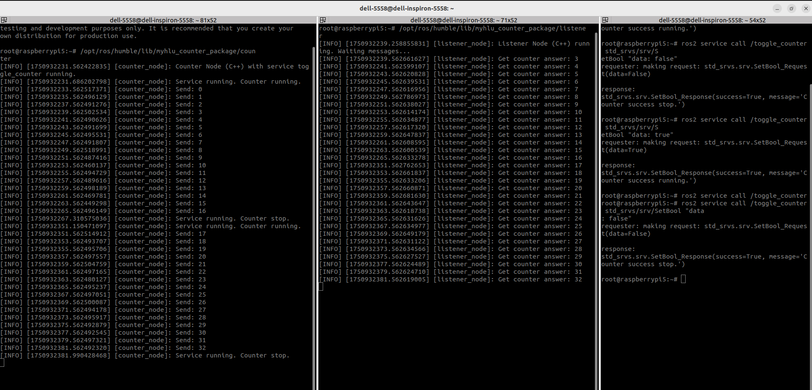

# Yoсto-myhlu-OS

This repository contains a custom operating system built using the **Yocto Project**. The OS is designed to integrate and verify the operation of robotic components (nodes and services).

## 🚀 Releases & Pre-built Images

The production-ready release image of the operating system is available for download in the **Releases** section.
* Download the latest build: **[OS-yocto Release 1.0](https://github.com)**

---

## 🛠 Meta Layer Integration

To implement and test the robot's functionality, a custom meta-layer has been integrated into the OS:
* 👉 **[meta-myhlu-robot](https://github.com/MykolaHlushchenko/meta-myhlu-robot)**

### Features implemented by this layer:
* **Two independent Nodes** that handle computational or communication tasks.
* **One Service** that coordinates or processes requests from the nodes.

You can easily verify the correctness of these components and their interaction directly inside the running OS.

---

## 📊 Verification & Node Communication

Below is a screenshot demonstrating the successful operation and message exchange between the robotic nodes within the OS:



---

## 📦 Repository Structure

* `build/conf/` — Yocto build configuration files (`local.conf`, `bblayers.conf`).
* `poky/` — Base Yocto Project environment (linked as a git submodule).

---

## 💻 How to Build the OS Manually

1. **Clone the repository along with its submodules:**
   ```bash
   git clone --recursive https://github.com/MykolaHlushchenko/OS-yocto
   cd OS-yocto
   ```

2. **Initialize the build environment:**
   ```bash
   source poky/oe-init-build-env build
   ```

3. **Start the image build process:**
   ```bash
   bitbake core-image-minimal
   ```